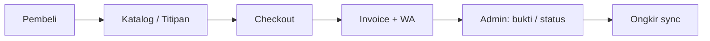

<p align="center">
  
</p>

<div align="center">

# NITIP DI END

**Jastip storefront + admin panel** for curated titipan: catalog, cart, checkout, WhatsApp invoice, ongkir estimator, and a neo-brutal ops dashboard — installable as a PWA.

[](https://laravel.com)
[](https://www.php.net)
[](https://tailwindcss.com)
[](#pwa)
[](#)

</div>

---

## Highlights

| | |
|---|---|
| 🛍️ **Storefront** | Neo-brutal cream/ink/yellow UI, catalog, viral picks, cart (`/titipan`) |
| 🧾 **Admin ops** | Orders, invoices, payment proofs, settings, ongkir sync |
| 🚚 **Ongkir** | Local zone estimator (free) + optional **api.co.id** / RajaOngkir live sync |
| 📱 **PWA** | Installable store + admin manifests, offline page, shortcuts |
| 🔐 **Keep secrets out of git** | Path guard + gitleaks in CI — [keep-it-out-of-git](https://github.com/Sultonisky/keep-it-out-of-git) |



---

## Stack

- **Backend:** Laravel 13 · PHP 8.5+
- **Frontend:** Blade · Tailwind CSS v4 · Alpine.js · Vite
- **Data:** MySQL / SQLite · session cart
- **Extras:** Web Push (VAPID) · sitemap.xml · JSON-LD SEO

---

## Quick start

```bash
git clone https://github.com/masmbull/jastip.git
cd jastip
composer install
npm install
cp .env.example .env
php artisan key:generate
```

Edit `.env` (at least `APP_URL`, DB, and optionally shipping):

```env
SEED_BOOTSTRAP_PASSWORD=your-private-12plus-chars
SHIPPING_API_PROVIDER=local
# SHIPPING_API_PROVIDER=api.co.id
# SHIPPING_API_KEY=        # never commit real keys
```

```bash
php artisan migrate:fresh --seed
php artisan storage:link
npm run build
php artisan serve
# http://127.0.0.1:8000
```

Windows tip: enable `pdo_sqlite` / `sqlite3` in `php.ini`, or use `.\serve.ps1`.

Demo admin after seed (local/testing only): username `admin` · password from `SEED_BOOTSTRAP_PASSWORD`.

---

## Scripts

| Command | Purpose |
|---|---|
| `npm run dev` | Vite HMR |
| `npm run build` | Production assets |
| `php artisan test` | PHPUnit (in-memory SQLite) |
| `bash scripts/check-sensitive-paths.sh` | Block secret/PII paths in git |
| `gitleaks detect --source . --config gitleaks.toml --redact --exit-code 1` | Secret content scan |

---

## Shipping / ongkir

Default provider is **local** (zone × weight from `config/ekspedisi.php`) — no API key.

Optional live sync from admin `/admin/ongkir`:

1. Set `SHIPPING_API_PROVIDER=api.co.id` and `SHIPPING_API_KEY` in **`.env`** (gitignored)
2. Open **Ongkos Kirim** → **Sinkronkan Tarif**

On Windows PHP without system CA roots, place `cacert.pem` under `storage/app/private/` (already gitignored).

---

## PWA

| Manifest | Start |
|---|---|
| `public/manifest.webmanifest` | Store `/` |
| `public/manifest-admin.webmanifest` | Admin `/admin` |

Service worker: `public/sw.js` · Offline: `public/offline.html`  
Install prompt: `<x-pwa-install />` (store) / `context="admin"` (panel).

---

## SEO

- Canonical + Open Graph + Twitter Card (`layouts/partials/seo`)
- Organization / WebSite JSON-LD + Product + BreadcrumbList on product pages
- Dynamic `GET /sitemap.xml` (active products & categories)
- `public/robots.txt` disallows admin, cart, checkout, auth

---

## Keep It Out of Git

This repo follows [Sultonisky/keep-it-out-of-git](https://github.com/Sultonisky/keep-it-out-of-git):

- Private storage: `storage/app/private/`
- CI: path blocklist + gitleaks in `.github/workflows/ci-cd.yml`
- Skills under `.agents/skills/`
- Never commit `.env`, dumps, or live API keys

---

## Production sketch

```bash
composer install --optimize-autoloader --no-dev
npm ci && npm run build
php artisan migrate --force
php artisan storage:link
php artisan config:cache && php artisan route:cache && php artisan view:cache
```

---

<div align="center">

**NITIP DI END** · built for real jastip ops · cream · ink · yellow

</div>
